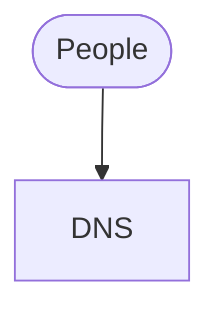

# <Org> infrastructure

How <org>'s systems run on AWS: every project, what they share, how they reach each
other, and where to go for each one's detail.

Everything here is Terraform in this repository's `infra/terraform/` and reaches AWS
only through `/deploy`. **Nothing is changed by hand in the AWS console** — a hand edit
shows up as a difference on the next plan and is undone. Every resource by name and
identifier is in the generated `infrastructure-reference.md`; who owns each one is in
`org-map.md`.

## At a glance

## Projects

| Project | What it is | Infra |
|---|---|---|
| <project> | | [projects/<project>/infrastructure.md](projects/<project>/infrastructure.md) |

## What the projects share

The servers, load balancers, network and zones more than one project uses, and what
each project adds onto them.

## How the projects reach each other

The APIs, logins and data one project uses from another — the detail is the "Between
projects" table in `org-map.md`.

## Other organizations

What reaches in from another organization, or out to one, and where each grant lives.

## Legacy systems

## Who can change what

Every change follows `infrastructure-access-and-change.md`.

## Open decisions
