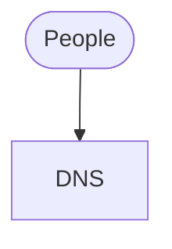

# <Project> infrastructure

How <project> runs on AWS: every piece, how a request reaches it, how a release reaches
it, who can reach what, and what to do when something has to change or goes wrong.

Part of [<Org>'s infrastructure](../../infrastructure-overview.md). The code is
`<owner>/<repo>`; its Terraform is here, in `infra/terraform/projects/<project>/`, and
every resource it holds is in the generated `infrastructure-reference.md`.

## At a glance

## The pieces

### Each environment

### Shared with other projects

What this project uses that the `shared` root owns, and what it adds onto each — a
routing rule, a security-group rule, DNS records.

### Reached by, or reaching, other projects

## How a request is served

## How code reaches each environment

## Who can reach what

## Backups

## Logs and monitoring

## Everyday operations

## Open decisions
