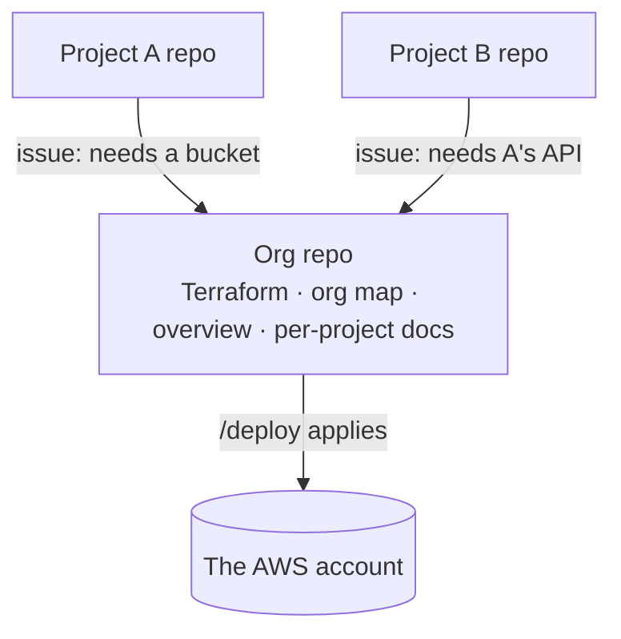

# Infrastructure as code with Terraform

For whoever owns a kit project's AWS infrastructure, and the Claude session walking them
through it. `infrastructure.md` describes the standard shape of what gets built; this is
how it is owned as Terraform in each organization's **org repo**, instead of console
clicks and CLI commands. Claude carries the procedures in the `terraform` skill; this page
is the model behind them. The commands are on one page in `org-repo-cheatsheet.md`.

## The idea, in Drizzle terms

Terraform is to AWS what Drizzle is to the database.

| Drizzle | Terraform | What it is |
|---|---|---|
| Schema files (`schema.ts`) | `.tf` files | What you want to exist. Lives in a repo, reviewed like any code |
| `drizzle-kit generate` | `terraform plan` | Compares what you want with what exists and shows every change before anything happens |
| `drizzle-kit migrate` | `terraform apply` | Makes the changes |
| The migrations table inside the database | **State file** | The record of what has been applied — and of which AWS resources Terraform owns |
| One `drizzle.config.ts` pointing at one database | **Root** | One folder of Terraform with its own state file |

Two differences matter:

- **Drizzle keeps its record inside the database. AWS has nowhere to put one**, so the
  state files live in an S3 bucket — the **state bucket**. The repo holds the code you
  change; the bucket holds the record of what was applied.
- **Drizzle assumes every table is its own. An AWS account holds plenty that is not
  Terraform's**, so the state file is also Terraform's list of what it owns, and
  Terraform never touches anything outside it. Each project gets its own roots, so a
  mistake in one project's code cannot plan a change to another's.

## Why bother

A hand-built resource drifts. A setting made once in the console — a metadata hop limit, a
log retention, a firewall rule — is forgotten the day the resource is rebuilt. Two
environments built by hand diverge from the first day. "Who may reach what" exists only as
console state nobody reviews.

And in an account several projects share, **the blast radius of a console change cannot
be seen**. A security group that looks unused may be what a legacy system depends on; the
console does not say. A Terraform plan says exactly what a change adds, changes and
destroys before it runs.

## The org repo

**Every organization has one org repo per AWS account, named `<org>-org`.** A second AWS
account gets a second org repo — mixing accounts buys nothing.

It is more than a Terraform repo. It is the one place for everything about the
organization, or that crosses between its projects:

- **All of the account's Terraform** — every project's resources, what projects share,
  the legacy systems. Every existing resource is adopted; nothing stays hand-managed,
  because anything left out is exactly the resource whose blast radius nobody can see.
- **The org map** — every project with infrastructure in the account, who owns each
  resource, what is deliberately not adopted and why.
- **What crosses between projects** — one project calling another's API or using its
  login, which credential, which side owns it. And across organizations: when another
  org's project reaches in, the grant is written in the org that owns the resource and
  recorded in both.
- **The infrastructure docs** — the org overview at the top, linking down to one doc per
  project, plus a reference generated from Terraform's own state.

**A project can be its own org repo** when an organization has one project and wants one repository: `REPO_KIND=combo` keeps the app and the Terraform together, running the org flow for infrastructure and the app flow for code (`org-repo-cheatsheet.md`).

**Otherwise project repos hold no Terraform.** Everything about one project's code — its
buildspecs, Dockerfiles, backup image — stays in the project. Each project with infrastructure in the account points up to its
org repo — its `ORG_REPO` setting, and its README unless the project is public, where a
link to a private org repo is a dead end that advertises it exists — so it can find out
what exists and who owns it, and one project can find another. A project with nothing in
the account is not involved: it is not pointed at the org repo, and the org map does not
list it. A dormant project with infrastructure is pointed the next time it is worked on.

## How a change happens

Say you are working in a project and it needs an S3 bucket for uploads.

1. **In the project**, Claude files an issue on the org repo describing the need — the
   paper trail — and the project's PR names it: `Needs <org-repo>#N`.
2. **In the org repo**, `/work <N>` picks it up. Claude plans the affected roots first;
   they should show no changes. If they do not, someone changed AWS outside Terraform,
   and that is settled before anything new is added.
3. Claude writes the Terraform and updates the project's infra doc.
4. **`/open-pr`** commits it, plans every changed root, and opens the PR with each plan
   and a plain-words summary: "adds a bucket and one permission; changes nothing else."
   CI checks the code.
5. **`/deploy`** makes it real: it waits for green CI, re-plans, applies only if the plan
   still does exactly what the PR showed, regenerates the reference, and merges. The
   org repo's main branch only ever holds what is live.
6. **Back in the project**, its `/deploy` refuses until the org change it needs is live,
   then ships the code that uses the bucket.

## The rules that make it work

- **Claude writes the code and plans it; a person's `/deploy` applies it.** Claude never
  applies on its own, and `/deploy` applies nothing the PR did not show.
- **Plan before every change.** A difference nobody asked for is a manual change, and
  stacking work on it hides it.
- **Nothing is changed in the console.** A hand edit shows up on the next plan and is
  undone by the next apply. Reading the console is fine.
- **Every Terraform resource is labelled.** A `ManagedBy` tag naming the repo and root
  shows on the resource's console page, so the person about to click sees that the change
  will be reverted.
- **No value a person sets goes in Terraform.** Everything Terraform sets is stored in plain text in
  its state. Parameter Store values are put in with `aws ssm put-parameter` and access keys
  created with `aws iam create-access-key`; Terraform creates only who may read them.
- **One owner per resource.** A resource two roots both manage is overwritten by whichever
  applied last. The skill lists the resource types that do this silently.

## Access and change

Every org repo works this way, whether or not anyone audits it:

- Only named people change infrastructure, each with their own multi-factor sign-in and a
  role session that carries their name (`role_session_name`), so CloudTrail names who did
  what.
- Claude holds no AWS credential of its own. It acts only inside the session of the person
  directing it, which expires within the hour.
- A planned change is an issue, a PR carrying the code and its plan, and a `/deploy` that
  applies exactly that plan. An unplanned change made directly in AWS is written back
  through a PR in the same session, or recorded as an issue when it is outside Terraform
  by design.

**An organization that must show its process** — an audit such as ISO 27001, a client's
security review — turns on the audit level once its org repo is set up: a written
access-and-change procedure with a mapping to the Annex A controls, an issue for every
change, and a CloudTrail trail that keeps the record past AWS's 90 days. A second
setting makes `/deploy` wait for a reviewer other than the author to approve; the
organization decides who approves, with its own people among them, before it is turned on.
While an org repo is first being set up, its setup issue is the record of everything done.

## The checks

- **The commit precheck** runs `terraform fmt -check` on every changed `.tf` file.
- **CI on the PR is the real gate**: `terraform fmt -check` across the repository and
  `terraform validate` in each root, with no credentials, plus semgrep.
- **Semgrep** findings worth knowing:
  - *Fix by adding the setting*: log retention, an explicit CodeBuild encryption key,
    load balancer access logs (a bucket per environment with a log-delivery policy and a
    lifecycle).
  - *Suppress with a reason* where the rule's concern does not apply: CloudWatch log
    groups without a customer key (service-managed encryption; IAM decides who reads),
    `ecr:GetAuthorizationToken` (no narrower form), `iam:PassRole` scoped to named roles
    and one service, an image repository with one deliberately mutable tag (a build cache).
  - *Where the marker goes*: `# nosemgrep: <rule id>` on the flagged line, or alone on the
    line directly above the resource. A reason comment between the marker and the
    resource stops it matching. Use the full rule id the scan prints.

## Credentials

The AWS provider cannot read the session `aws login` creates, so the kit's `tf.sh` exports
the profile's temporary credentials into its own process and runs Terraform. It reads the
profile, region and account from the repo's settings and refuses to run when the
credentials belong to any other account; each root's provider also refuses any account but
its own (`allowed_account_ids`). Because the credentials never enter the calling shell,
sessions working in different accounts at the same time cannot cross.

## What stays outside Terraform

- Parameter Store values a person sets, and access keys. Terraform publishes only the values it creates itself — a bucket's name, a queue's URL.
- The state bucket itself.
- The role the operators assume into the account, and its trust — a bad apply would lock
  everyone out.
- The account owner's people's sign-in identities, and the root user.
- What AWS creates itself: the default VPC, service-linked roles, AWS-managed policies.
- Resources in other providers a project uses (the database host, the identity provider,
  the uptime monitor), unless that provider's Terraform support is worth a second provider.
